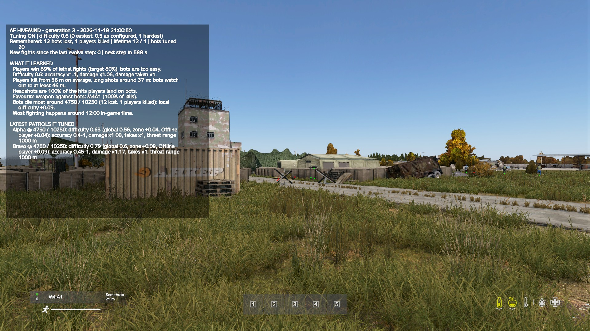

# AF HiveMind

A DayZ mod that watches how players and [DayZ Expansion AI](https://steamcommunity.com/sharedfiles/filedetails/?id=2792982069) bots fight, remembers it in a file that keeps evolving, and tunes every newly spawned patrol bot from what it has learned.



**Running a server? Read the [guide for server owners](docs/SERVER_GUIDE.md).** It covers installing (self-hosted and on hosts such as GTX or Nitrado), becoming an admin, the F9 and F10 panels, every setting, common recipes, and troubleshooting. The rest of this page is for people working on the mod.

## What it does

**Observes** (server side, players versus bots only):

- who killed whom, from how far, with which weapon, where on the map and at what in-game hour
- hits and headshots players land on bots, hits bots land on players
- where players spend their time

**Learns.** Every ten minutes (the evolve step) it compares the share of lethal fights the players win with a target (80% by default) and moves a single difficulty figure between 0 and 1. Memory fades with a half-life of 72 hours, so the bots follow how people play now, not last month.

The figure follows the whole community, not its best player. No player counts for more than `PlayerFightsCap` (8) remembered fights: a player with more still counts with their own win rate, scaled down to 8 fights. The difficulty only moves once `DifficultyMinFights` (20) fights count, all players together, and no player adds more than `PlayerFightsPerStepMax` (3) fights to one evolve step. With the defaults, at least three players must have fought bots before it moves. Set `PlayerFightsCap` to 0 for no cap.

**Adjusts.** Each bot a patrol spawns keeps the patrol's own settings, scaled by the difficulty:

| Knob | At difficulty 0 | At 0.5 | At 1 |
|---|---|---|---|
| Accuracy | x0.6 | as configured | x1.5 |
| Damage dealt | x0.75 | as configured | x1.3 |
| Damage received | as configured (scaling is off by default) | | |
| Sight (threat range) | x0.75 | as configured | x1.1, never past 1,100 m (Expansion caps bot visibility there) |
| Hearing (how far a bot goes to check a gunshot) | x0.7 | as configured | x1.3 |

Two local corrections can sit on top of the global figure: bots in a 500 m zone where players farm them get up to +0.15 (`ZoneOffsetMax`), and the reverse where bots dominate. Bots spawning near a player who rarely loses can get up to `PlayerOffsetMax` extra; that is 0 (off) since 0.4.0, and an older `config.json` still holding the old default 0.2 is moved to 0 automatically.

**Hot zones.** An ordinary patrol (not a quest or object patrol) spawning in a zone where players win far more often than the target comes out bigger: up to `HotZoneExtraShareMax` (50%) more bots, never more than `HotZoneExtraBotsMax` (3) extra. The extra bots are added by raising the patrol's `m_NumberOfAI` while Expansion sets up its first bot, before it spawns the others, so Expansion spawns and manages them as ordinary members. Saved (`Persist`) patrols are never made bigger. `HotZoneExtraBots` switches it off.

Every limit above is a number in `config.json`. `config.json` is written back each time it is read, so settings added in a newer version appear in an older file with their defaults, while your own values are kept.

**Announcements.** When the threat level (1-10, 5 = as configured) changes for the whole map, or a farmed area moves above or below the map's level, every player gets an Expansion notification naming the area (nearest town) and what changed. `Notify`, `NotifyPlayers` (false = admins only), `NotifyAreasMax` and `NotifySeconds` control it. The first start after an install or update only records the level.

**Night counter.** Each lethal fight is marked day or night by the bot's own reckoning: Expansion's daylight figure, which it also uses to decide when bots switch on lights and NVG. Once the night share passes `NightShareStart` (30%), up to `NightGearShareMax` (50%) of new patrol bots get night-vision goggles on a headstrap; the full share is reached at `NightShareFull` (70%). Bots switch them on themselves at night. With `NightGearLootable` false (the default), the goggles are removed when the bot dies.

**Bounty loot.** A bot tuned above `BountyFromDifficulty` (0.6) and killed by a player may drop one extra item where it falls, from `BountyCommon` or `BountyRare`. The chance rises to `BountyChanceMax` (75%) at difficulty 1, and the rare share to `BountyRareShareMax` (50%). Unknown class names are logged and skipped.

**Saved patrols.** Patrols that Expansion saves across restarts (`Persist`) are tuned, but their weapons and gear are never changed, because they are rebuilt from the save on every restart.

**Range counter.** Each bot kill is sorted by distance: beyond `LongRangeDistance` (150 m) counts as sniping, within `CloseRangeDistance` (40 m) as rushing. Once the community clearly leans one way:

- Bots' flanking distance grows up to `FlankWiderMax` (x1.5) against snipers and shrinks to `FlankNarrowerMin` (x0.6) against rushers.
- Up to `RoleShareMax` (40%) of new patrol bots swap their long gun for one from `MarksmanLoadout` or `AssaultLoadout`. Set `RoleShareMax` to 0 to keep flanking but never change weapons.
- `AdaptTactics` switches the whole range counter off.

The two loadouts, `AFHM_MarksmanWeapons.json` and `AFHM_AssaultWeapons.json`, are written once to `ExpansionMod\Loadouts` with vanilla weapons only. Edit them like any Expansion loadout, or point the config at your own. They hold weapon sets only: a bot keeps its patrol's clothes and gear. Bots from other mods (convoys, vehicle crews) get the flanking change but keep their own weapons.

**Bots from other mods.** Bots that other mods create without a patrol (Moving AI Convoy, BS Patrol Helicopter and Tank) are tuned `OtherBotsDelaySeconds` (3) after they appear, from whatever their own mod set. Bots following a player, quest givers and traders are never tuned, and fights with quest givers or traders are not counted. `TuneOtherBots` switches this off.

## Files it keeps

In the server profile folder, under `AFHiveMind\`:

| File | What it is |
|---|---|
| `config.json` | Switches and limits. Written with defaults on first start, re-read at every evolve step, so it can be edited while the server runs. |
| `brain.json` | Everything it has learned. Readable, hand-editable; delete it to start over. |
| `report.txt` | The same knowledge in plain words, rewritten at every save. |
| `hivemind.log` | Journal: every change of mind, every fight it saw (`DebugLevel` 1), every bot it tuned (`DebugLevel` 2). |

## Debug panel and admin controls

Press **F9** in game (rebindable under Controls > AF HiveMind). It shows the current generation and difficulty, what was learned in plain words, and the latest patrols it tuned with the reason for each figure. On a server, only Steam64 ids listed under `Admins` in `config.json` get the report.

Press **F10** for the admin controls: the same report with the mouse cursor and these buttons. Esc or Close shuts it. If you had the mod before 0.3.0, DayZ may leave this key blank for you: bind it under Controls > AF HiveMind > AF HiveMind admin controls.

| Button | What it does |
|---|---|
| Freeze learning / Resume learning | While frozen, no fights are recorded and nothing fades. Bots are still tuned from what it knows, and hard bots still drop bounty loot. Same as `Frozen` in `config.json`. |
| Pin difficulty, Pin -0.05, Pin +0.05 | Holds the global difficulty at the current figure, or 0.05 lower or higher. Fights are still learned from (tactics, zones, players), but do not move it. Zone and player corrections still apply on top. Same as `PinnedDifficulty`. |
| Unpin | Lets the difficulty learn again, starting from where it was pinned. |
| Evolve now | Runs the ten-minute learning step at once. |
| Reset brain | Click twice. Starts over with an empty brain; the old one is kept as `backups\reset_brain_<date>_<time>.json`. Settings, the freeze and the pin are kept. |

Every button is checked against `Admins` on the server and written to `hivemind.log` with the admin's name.

## Installing

Requires CF, Dabs Framework, DayZ-Expansion-Core and DayZ-Expansion-AI.

- **With the debug panel:** load `@AFHiveMind` with `-mod=` on the server and on every client, and copy `Keys\AFHiveMind.bikey` to the server's `keys` folder.
- **Without it:** load it with `-serverMod=` on the server only. Players download nothing; use `report.txt` and `hivemind.log` instead of the panel.

It only touches bots spawned by Expansion patrols (including object patrols and quest AI, which use the same patrol class).

## Releasing

Run this before every Workshop upload:

```powershell
powershell -ExecutionPolicy Bypass -File tools\release.ps1
```

It stops unless you are on `main`, with nothing uncommitted and nothing newer on GitHub. It checks that `config.cpp` and `AFHM_Const.VERSION` carry the same version and that `workshop\changenotes_<version>.txt` exists. Then it builds, signs and runs the offline test. The offline test is what compiles the scripts: `build.ps1` only packs them, so a script error would otherwise first show up on a live server. When everything passes, it prints the content folder for the DayZ Tools Publisher and copies the change notes to the clipboard. It never publishes anything itself.

## Building and testing

```powershell
powershell -ExecutionPolicy Bypass -File tools\build.ps1
```

packs `source\AFHiveMind` into `@AFHiveMind\Addons` and signs it with `keys\AFHiveMind.biprivatekey` (not in git; create one with DayZ Tools' DSCreateKey).

```powershell
powershell -ExecutionPolicy Bypass -File testmission\run_test.ps1 -Fresh
```

runs an offline mission in DayZDiag: a patrol spawns on an empty brain, the player's rifle kills it, the HiveMind evolves, a second patrol must come out harder and, because it spawns in the zone where the first one died, bigger. A bot then kills the player. Leave out `-Fresh` to run again on the brain the last run saved. It ends with `TEST PASSED` or `TEST FAILED`, and exit code 0 or 1.

What the offline test cannot show: bots do not manage to fire in offline DayZDiag (their weapons fail to chamber), so the player's death is dealt by script as melee damage from a bot, and bullet hits on bots are dealt by script with the player's rifle as the source.

```powershell
powershell -ExecutionPolicy Bypass -File testmission\run_server_test.ps1
```

runs the real thing: DayZDiag as a local dedicated server and a client that connects to it, with Bohemia's stock mission files (clone https://github.com/BohemiaInteractive/DayZ-Central-Economy to `C:\DayZMods\_external\DayZ-Central-Economy` first). It brings the client window to the front and clicks the mouse in it, so leave the PC alone for the five minutes it takes. On the server it has shown:

- Expansion's own patrols across the map being tuned as they spawn
- bots killing the player with real bullets while their damage multiplier was not 1, and the HiveMind recording the death
- a real bullet killing a bot whose damage-received multiplier was 0.92 (a raider's shot on a target bot), so Expansion's handling of scaled damage works with HiveMind's values
- the debug panel over the network, refused for a player who is not listed under `Admins` and shown once listed

Still not shown by any automated test: a player's own bullet killing a bot. The test player's rounds are fired by the server but none hits, which is a limit of driving a character by script. To check it, join a server running the mod, shoot a bot, and look for `seen: <your name> killed a bot` in `hivemind.log`.

`testmission\testmod\AFHiveTest` is a helper mod for this test only (it raises the test player's rifle and opens the panel on the server's order). Never load it on a real server.
## How it hooks into Expansion

Three overrides, in `Scripts\4_World\AFHiveMind\AFHM_Hooks.c`:

- `eAIDynamicPatrol.SetupAI` - tune a bot after Expansion applied the patrol's settings
- `PlayerBase.EEKilled` and `PlayerBase.EEHitBy` - record player-versus-bot kills and hits
- `PlayerBase.OnRPC` - the debug panel's request and report, and the admin controls' commands

If an Expansion update breaks the mod, these are the places to look.
